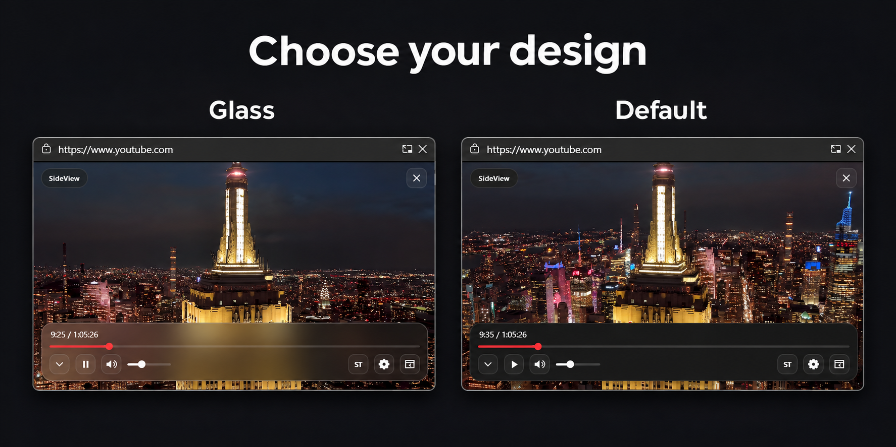
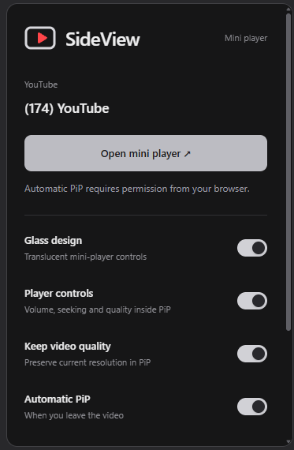

# SideView

[English](#english) · [Русский](#russian)

<a id="english"></a>

## English

First public release — **1.0.0**.

Watch YouTube in a small window above your other apps. Move and resize the player, pause a video, and keep watching while you work, chat, or play in windowed mode.

SideView is a Manifest V3 extension for desktop Chrome and Edge, designed for Windows 10/11. It uses the browser's built-in picture-in-picture APIs. The browser and the video tab must stay open.

### Screenshots



Choose translucent or solid controls with the **Glass design** switch in the extension menu.



### Installation

1. Download **SideView.zip** from [Releases](https://github.com/kassmerk/SideView/releases/latest) and extract it. Alternatively, download the repository using **Code → Download ZIP** and extract it.
2. Open `chrome://extensions` in Chrome or `edge://extensions` in Edge.
3. Enable **Developer mode**.
4. Click **Load unpacked** and select the extracted folder containing `manifest.json`. For **SideView.zip** from Releases, select the extracted **SideView** folder; for the repository ZIP, select its **extension** folder.
5. Pin SideView to the toolbar using the browser's extensions menu.
6. Open a video at `https://www.youtube.com`, start playback, and click **SideView → Open mini player**.

Node.js is only needed for development.

#### If you see “Cannot read properties of undefined (reading 'query')”

The page has no access to extension APIs. This usually happens when `popup.html` is opened as a regular file, through a local server, or in an editor preview. Install the `extension` folder through the browser's extensions page, then open SideView from the toolbar while viewing YouTube.

Current versions display installation instructions in this situation. If SideView is already installed, click **Reload** on its extension card, refresh the YouTube tab, and open the popup again.

### Controls

**Player controls** enables a Document Picture-in-Picture window with custom playback controls. Supported Chrome/Edge versions provide Play/Pause, a red seek bar, a gray buffered indicator, mute, a volume slider, elapsed time, subtitles through **ST**, settings, return to tab, and close. Controls appear when the pointer enters the player and fade out when it leaves. The arrow on the left collapses and expands the panel manually.

The settings menu provides playback speed, a sleep timer, and available video quality options. The extension menu also provides **Glass design** and an **English / Русский** language selector.

Space or K toggles playback, M toggles mute, and the left/right arrow keys seek by 10 seconds. Sliders retain their normal keyboard behavior. Seeking is disabled for live streams without a finite duration.

The original video element moves into the floating window, preserving its stream. When the window closes, the element returns to its previous position. If the original page has been replaced, the old video is stopped. Moving the element can affect YouTube's behavior, so subtitles, ads, Shorts, and automatic transitions to the next video need testing on real watch pages.

Selecting a quality in settings updates **Keep video quality** and the pinned resolution. **Auto** disables enforcement and requests automatic quality. YouTube controls which streams are available.

If Document PiP is unavailable or fails to open, SideView tries standard video PiP. You can select this mode by turning off **Player controls** and reopening the mini player. The browser controls the standard PiP interface. [Document PiP documentation](https://developer.chrome.com/docs/web-platform/document-picture-in-picture).

SVG controls are built with DOM methods to support Trusted Types restrictions. Earlier development builds could close a newly opened window when HTML string assignment was blocked. A regression test models that restriction and checks opening, playback controls, and video restoration. After updating the extension, reload the YouTube tab to replace its injected scripts.

| Action | How |
| --- | --- |
| Open the floating player | SideView icon → Open mini player |
| Pause or resume | Hover over the player and press Play/Pause |
| Move | Drag the floating window |
| Resize | Drag an edge or corner |
| Close | Use the close button. Playback may continue in the tab |
| Return the video | Use the return button in the floating window or in SideView |

Window sizing limits and native window chrome are controlled by the browser. PiP may not appear above exclusive fullscreen games, the secure desktop, or some system windows.

### Automatic picture-in-picture

**Automatic PiP** is enabled by default. SideView registers a Media Session `enterpictureinpicture` handler. When the browser allows Auto PiP, it can invoke this handler when you leave the video, such as when switching tabs or minimizing the browser.

In Chrome:

1. Open YouTube and its site settings using the icon next to the address.
2. Allow **Automatic picture-in-picture** if the setting is available, or respond to the browser's permission prompt.
3. Play a video **with sound**, then switch tabs or minimize the browser.

Automatic opening depends on browser version, permissions, playback state, audio focus, and other conditions. Edge support depends on its implementation. Manual opening is available as a fallback. Unsupported automatic controls are disabled. A supported handler does not mean permission has already been granted.

By default, an automatically opened window returns to the tab when you return to YouTube. You can turn this off in SideView, although the browser can also close an automatically created window. SideView keeps manually opened windows open when you return. If you close PiP while the tab is in the background, SideView suppresses another automatic request until you visit the tab again.

A regular `visibilitychange` callback cannot reliably open PiP without a user gesture or a browser-authorized automatic action.

References: [Auto PiP for media playback](https://developer.chrome.com/blog/automatic-picture-in-picture-media-playback), [browser-initiated Auto PiP](https://developer.chrome.com/blog/automatic-picture-in-picture-initiated-by-the-browser), [video PiP](https://developer.chrome.com/blog/watch-video-using-picture-in-picture).

### Keeping video quality

**Keep video quality** is enabled by default. Before opening PiP, SideView remembers the current resolution and requests it from YouTube's player. For automatic PiP, it uses the last resolution observed while the tab was visible, so it can retain the quality before a background downgrade. While PiP is open, it checks every 1.5 seconds and repeats the request if needed. A selected 1080p resolution is retained even when 4K is also available.

Enforcement stops when PiP closes, the switch is disabled, or the video changes. SideView does not force the selected quality back to Auto on exit. Each video's resolution is captured separately. Selecting a different resolution in the PiP settings updates the target. Selecting **Auto** releases enforcement.

This feature uses the main YouTube player's internal `setPlaybackQualityRange` method. YouTube may change these methods or ignore a request because of available streams, network conditions, or account limits. SideView cannot provide a resolution the video does not offer. When control is unavailable or a request is ignored, the interface reports the limitation and playback remains available. You can also choose a fixed quality in YouTube's own settings. [Official IFrame API quality changes](https://developers.google.com/youtube/iframe_api_revision_history#october-24,-2019), [another extension using the internal method](https://github.com/Batuhan4/autohd-youtube).

Automated tests use a simulated player. Compatibility with a specific live video requires browser testing.

### Limitations

- Supports `www.youtube.com` and `m.youtube.com`. Firefox, Safari, and YouTube iframes embedded on other sites are outside the current scope.
- Requires Manifest V3, MAIN-world content scripts, and picture-in-picture support. The manifest minimum is Chrome 111. Document PiP and automatic mode require newer browser support.
- Playback ends when its source tab or browser closes.
- Preferences are stored in YouTube's local storage for the current browser profile and domain. Clearing site data resets them. Preferences are not synchronized, and the site can technically read or modify them.
- SideView uses the site's Media Session. YouTube or another extension may replace the automatic handler. SideView registers it again on playback and in-page navigation. Other PiP extensions may conflict.
- Browser API tests do not confirm real permission behavior or compatibility with every YouTube version. Live testing is needed before a public release.

### Development

#### Returning from PiP

The `disablePictureInPicture` flag is restored after the video leaves PiP. Restoring it while PiP is active can close the native window. On return to the tab, SideView lets the browser finish its automatic exit before closing any remaining window. Concurrent close requests share an operation. Waiting for exit does not hold the opening lock. The popup chooses its action from the current page state. [Picture-in-Picture specification](https://www.w3.org/TR/picture-in-picture/#disable-pip).

After updating the extension, refresh any open YouTube tabs. MAIN-world scripts remain in the page until it reloads.

Node.js 18+ is required for development. There are no external dependencies.

```sh
node --check extension/player.js
node --check extension/popup.js
node --check extension/pip-window.js
node --check extension/locales.js
node --test tests/*.test.cjs
```

You can also run `npm run check` and `npm test` if npm is installed.

```text
extension/
  manifest.json       # Permissions and entry points
  player.js           # Video selection, PiP, preferences, automatic mode
  pip-window.js       # Custom controls and original-video restoration
  popup.html          # Extension popup
  popup.css
  popup.js            # Communication with the active tab
  locales.js          # English and Russian interface translations
tests/
  player.test.cjs     # Simulated player and browser APIs
  popup.test.cjs      # Popup controls and tab connection
  pip-window.test.cjs # DOM controls and Document PiP lifecycle
docs/images/          # README screenshots and comparison banner
```

After editing, click **Reload** on the extension card and refresh YouTube. To package the extension in PowerShell:

```powershell
New-Item -ItemType Directory -Force dist
Compress-Archive -Path extension/* -DestinationPath dist/SideView.zip -Force
```

For local installation, extract the ZIP and load the folder containing `manifest.json`. Store-based installation requires publication in Chrome Web Store or Microsoft Edge Add-ons.

### Before release

- Test regular videos and Shorts with manual opening, pause, resume, moving, resizing, and closing.
- Check messages for tabs without videos, loading videos, and blocked PiP.
- Test Auto PiP with permission granted, switching tabs, and minimizing during audible playback.
- Confirm that automatic requests stop when the setting is off or playback is paused.
- Test return-to-tab behavior with its setting on and off.
- Navigate to another video without a full page reload.
- Test subtitles, both interface languages, glass/default appearance, and panel collapse.
- Test Chrome and Edge separately and record their versions.

### Privacy

SideView has no analytics and does not send user data to an external server. It runs on YouTube. `activeTab` and `scripting` let the popup communicate with the selected tab after an extension click. The registered YouTube content scripts support automatic mode. SideView does not request browser history, passwords, or cookies.

### License

[MIT](LICENSE).

---

<a id="russian"></a>

## Русский

Первый публичный релиз — **1.0.0**.

YouTube в небольшом окне поверх остальных приложений. Смотри видео, пока работаешь, играешь в оконном режиме или общаешься: окно можно перемещать, изменять в размере, ставить видео на паузу и закрывать.

Расширение Manifest V3 для настольных Chrome и Edge, ориентированное на Windows 10/11. Использует встроенный Picture-in-Picture браузера: отдельный видеопоток, сервер и скачивание роликов не нужны. Браузер и вкладка с видео остаются запущенными.

### Скриншоты интерфейса


Выбери стеклянное или обычное оформление переключателем **Glass design** в меню расширения.

Меню SideView с настройками стеклянного оформления, качества и автоматического режима.


### Установка

1. Скачай **SideView.zip** из раздела [Releases](https://github.com/kassmerk/SideView/releases/latest) и распакуй. Или скачай репозиторий через **Code → Download ZIP** и распакуй его.
2. Открой `chrome://extensions` в Chrome или `edge://extensions` в Edge.
3. Включи **Режим разработчика**.
4. Нажми **Загрузить распакованное расширение (Load unpacked)** и выбери распакованную папку с `manifest.json`. Для **SideView.zip** из Releases это папка **SideView**, а для архива репозитория — папка **extension** внутри него.
5. Закрепи SideView на панели расширений через значок пазла.
6. Открой видео на `https://www.youtube.com`, запусти его и нажми **SideView → Открыть мини-плеер**.

Устанавливать Node.js для использования расширения не нужно.

#### Если интерфейс пишет «Cannot read properties of undefined (reading 'query')»

Это означает, что страница не получила API расширений браузера. Обычно причина — открытие `popup.html` двойным щелчком, через локальный сервер или в предпросмотре редактора. Установи папку `extension` через страницу расширений по инструкции выше, открой YouTube и запускай SideView через значок расширения на панели браузера. HTML-файл не является отдельным приложением.

В обновлённой версии вместо этой ошибки отображается инструкция по установке. Если SideView уже установлен, нажми «Обновить» на его карточке на странице расширений, обнови вкладку YouTube и заново открой всплывающее окно через панель браузера.

### Управление

Переключатель **Player controls** по умолчанию включает окно Document Picture-in-Picture со своей панелью управления в стиле YouTube. В Chrome/Edge с поддержкой этого API внутри окна доступны Play/Pause, перемотка по красной шкале, Mute, ползунок громкости, время над перемоткой, серые участки загрузки, субтитры через ST и настройки через шестерёнку, возврат во вкладку и закрытие. Панель плавно появляется при наведении и скрывается при уходе курсора. Стрелка в углу позволяет свернуть и раскрыть управление вручную.

В шестерёнке доступны скорость воспроизведения, таймер сна и качество. В меню расширения можно выбрать стеклянное или обычное оформление и язык интерфейса — English / Русский.

Пробел / K — пауза, M — звук, стрелки влево/вправо — переход на 10 секунд. Ползунки сохраняют своё обычное управление клавишами. У прямых трансляций без конечной длительности перемотка в этой версии отключена.

В мини-плеер перемещается исходный элемент видео, без копирования потока, записи экрана и перекодирования. При закрытии он возвращается на прежнее место; если исходная страница уже заменена, старое видео останавливается, чтобы не подмешивать его к новому ролику. Субтитры и другие HTML-слои YouTube, реклама и автоматический переход к следующему ролику требуют отдельной проверки: перемещение элемента может влиять на поведение сайта. Изменять качество можно только когда внутренние методы плеера доступны; в противном случае меню объясняет ограничение.

Выбор конкретного качества в шестерёнке обновляет **Keep video quality** и удерживаемое разрешение. **Auto** отключает удержание и запрашивает автоматическое качество. Эти запросы зависят от YouTube и не гарантируют доступ к отсутствующим потокам.

Если Document PiP недоступен или не открылся, SideView пробует обычное окно PiP без своей панели. Также обычный режим можно выбрать, выключив **Player controls** и заново открыв мини-плеер. [Документация Document PiP](https://developer.chrome.com/docs/web-platform/document-picture-in-picture).

Исправлена ошибка построения панели при ограничениях Trusted Types: SVG-кнопки создаются через DOM, без присваивания HTML-строк. Раньше исключение при создании кнопок могло закрывать только что открытое окно. Тест моделирует запрет `innerHTML` и проверяет открытие, управление и возврат видео. После обновления нажми Reload у расширения и перезагрузи вкладку YouTube, чтобы заменить обе старые части скрипта.

| Действие | Как выполнить |
| --- | --- |
| Открыть окно поверх приложений | Значок SideView → «Открыть мини-плеер» |
| Поставить на паузу / продолжить | Навести мышь на мини-плеер и нажать кнопку воспроизведения |
| Переместить | Перетащить окно мышью |
| Изменить размер | Потянуть за край или угол |
| Закрыть мини-плеер | Крестик в окне; воспроизведение может продолжиться во вкладке |
| Вернуть видео | Кнопка возврата в самом окне или в SideView |

Внешний вид, доступные кнопки и пределы размера задаёт браузер. Поверх полноэкранных игр, защищённого рабочего стола и некоторых системных окон PiP может не отображаться.

### Автоматическое появление при сворачивании

В SideView по умолчанию включена настройка **Открывать автоматически**. Расширение регистрирует обработчик Media Session `enterpictureinpicture`. Когда браузер разрешает Auto PiP, он вызывает обработчик при уходе с видео, например при переключении вкладки или сворачивании окна.

В актуальном Chrome:

1. Открой YouTube и настройки сайта через значок слева от адреса.
2. Если доступен пункт **Автоматическая картинка в картинке**, разреши его. Если браузер сам покажет запрос разрешения, подтверди его.
3. Запусти видео **со звуком** и переключись на другую вкладку или сверни браузер.

**Автоматическое появление не гарантируется на каждой версии браузера.** Chrome учитывает воспроизведение, звуковой фокус, разрешение сайта и другие условия. В Edge автоматический режим зависит от реализации браузера; ручное открытие остаётся основным запасным способом. Если обработчик не поддерживается, переключатели автоматического режима недоступны. Наличие обработчика само по себе не подтверждает, что браузер уже дал разрешение.

По умолчанию автоматически открытое окно возвращается во вкладку при возвращении на YouTube. Это можно отключить в SideView, хотя сам браузер тоже может закрывать автоматически созданный PiP. Окно, открытое вручную, расширение при возвращении не закрывает. Если закрыть окно в фоне, SideView не запрашивает его повторно до следующего посещения вкладки.

Не пытайся включать PiP через обычный `visibilitychange`: без пользовательского жеста или разрешённого браузером автоматического действия такой запрос обычно блокируется.

Документация: [Auto PiP for media playback](https://developer.chrome.com/blog/automatic-picture-in-picture-media-playback), [browser-initiated Auto PiP](https://developer.chrome.com/blog/automatic-picture-in-picture-initiated-by-the-browser), [Picture-in-Picture API](https://developer.chrome.com/blog/watch-video-using-picture-in-picture).

### Сохранение качества в PiP

Переключатель **Keep video quality** включён по умолчанию. Перед открытием мини-плеера SideView запоминает текущее разрешение и запрашивает его у плеера YouTube. При автоматическом PiP используется последнее качество, наблюдавшееся в видимой вкладке, чтобы не запомнить уже сниженное в фоне разрешение. Пока PiP открыт, расширение проверяет качество раз в 1,5 секунды и повторяет запрос при снижении. Например, выбранные 1080p не заменяются на 4K только потому, что оно доступно.

После выхода из PiP, выключения переключателя или смены видео удержание прекращается. Уже выбранное разрешение не сбрасывается принудительно на Auto. Для другого ролика качество запоминается заново. Выбор другого разрешения в шестерёнке обновляет удерживаемое качество. Пункт **Auto** отключает удержание.

Это попытка удержать разрешение через внутренний `setPlaybackQualityRange` основного плеера YouTube, а не гарантия качества или битрейта. [Официальный IFrame API больше не поддерживает управление качеством](https://developers.google.com/youtube/iframe_api_revision_history#october-24,-2019); использование внутреннего метода встречается и в [других расширениях](https://github.com/Batuhan4/autohd-youtube). YouTube может изменить эти методы или отклонить запрос из-за доступных потоков, сети и ограничений аккаунта. SideView не создаёт отсутствующие разрешения. Если методы недоступны или запрос не применяется, в интерфейсе появится сообщение; само открытие PiP продолжит работать. В таком случае выбери фиксированное качество в настройках YouTube вручную.

Проверки этой функции используют моделируемый плеер; работа на конкретном живом ролике требует проверки в браузере.

### Ограничения

- Только основной сайт YouTube и его мобильный домен. Firefox, Safari и встроенные YouTube-iframe на других сайтах не поддерживаются.
- Требуется браузер с Manifest V3, MAIN world content scripts и Video Picture-in-Picture. Минимальная версия Chrome в манифесте — 111; для автоматического режима нужен более новый браузер, поддерживающий этот API.
- Это расширение, а не отдельный `.exe`. После закрытия вкладки или браузера воспроизведение прекращается.
- Настройки сохраняются в локальном хранилище сайта YouTube для текущего профиля и домена. Очистка данных сайта сбросит их; синхронизации нет. Сайт технически может читать или менять эти настройки.
- Используется Media Session сайта. YouTube или другое расширение может заменить автоматический обработчик; SideView повторно регистрирует его при начале воспроизведения и переходах внутри YouTube. Другие расширения PiP могут конфликтовать.
- Визуальная проверка на реальном YouTube необходима перед публикацией релиза: автоматические тесты моделируют API браузера и не подтверждают выдачу разрешений или совместимость конкретной версии YouTube.

### Разработка

#### Возврат из PiP

Флаг `disablePictureInPicture` восстанавливается только после фактического выхода из PiP: его установка во время активного PiP может закрыть окно по [спецификации](https://www.w3.org/TR/picture-in-picture/#disable-pip). При возвращении во вкладку расширение даёт браузеру завершить автоматический выход, затем при необходимости закрывает оставшееся окно. Повторные запросы закрытия объединяются; ожидание закрытия больше не удерживает блокировку открытия. Кнопка интерфейса выбирает действие по актуальному состоянию страницы.

После обновления расширения обязательно перезагрузи открытую страницу YouTube: уже внедрённый MAIN-world скрипт сохраняется до перезагрузки страницы.

Нужен Node.js 18+; внешних зависимостей нет.

```sh
node --check extension/player.js
node --check extension/popup.js
node --check extension/pip-window.js
node --check extension/locales.js
node --test tests/*.test.cjs
```

Либо `npm run check` и `npm test`, если npm установлен.

```text
extension/
  manifest.json   # Разрешения и точки входа
  player.js       # Выбор видео, PiP, настройки и автоматический режим
  popup.html      # Интерфейс расширения
  popup.css
  locales.js      # Английский и русский языки интерфейса
  popup.js        # Связь интерфейса с текущей вкладкой
  pip-window.js   # Окно Document PiP, панель и возврат исходного видео
tests/
  player.test.cjs # Поведение с моделируемыми браузерными API
  popup.test.cjs  # Сценарии интерфейса и соединения с вкладкой
  pip-window.test.cjs # DOM, управление видео и закрытие Document PiP
```

После изменения файлов нажми **Обновить** на карточке расширения и обнови страницу YouTube. Готовый ZIP расширения можно создать в PowerShell:

```powershell
New-Item -ItemType Directory -Force dist
Compress-Archive -Path extension/* -DestinationPath dist/SideView.zip -Force
```

Для локальной установки ZIP нужно распаковать и выбрать папку с `manifest.json`. Установка в один клик потребует публикации в Chrome Web Store или Microsoft Edge Add-ons.

### Проверка перед релизом

- Обычный ролик и Shorts: ручное открытие, пауза, продолжение, перемещение, изменение размера и закрытие.
- Вкладка без видео, ещё загружающееся видео и запрещённый PiP: понятные сообщения.
- Разрешённый Auto PiP: переключение вкладки и сворачивание браузера во время воспроизведения со звуком.
- Выключенный автоматический режим и ролик на паузе: расширение не запрашивает автоматическое открытие.
- Возврат к YouTube с включённым и выключенным возвратом во вкладку.
- Переход на следующий ролик без полной перезагрузки страницы.
- Проверка ST, обоих языков интерфейса, стеклянного/обычного дизайна и сворачивания панели.
- Отдельная проверка Chrome и Edge с записью версии браузера.

### Приватность

Расширение не содержит аналитики, сетевых запросов и отправки пользовательских данных. Работает только на YouTube. `activeTab` и `scripting` используются для обращения к выбранной вкладке после нажатия на расширение. Регистрация скрипта на YouTube нужна для автоматического режима. История браузера, пароли и cookies расширению не нужны.

### Лицензия

[MIT](LICENSE).
